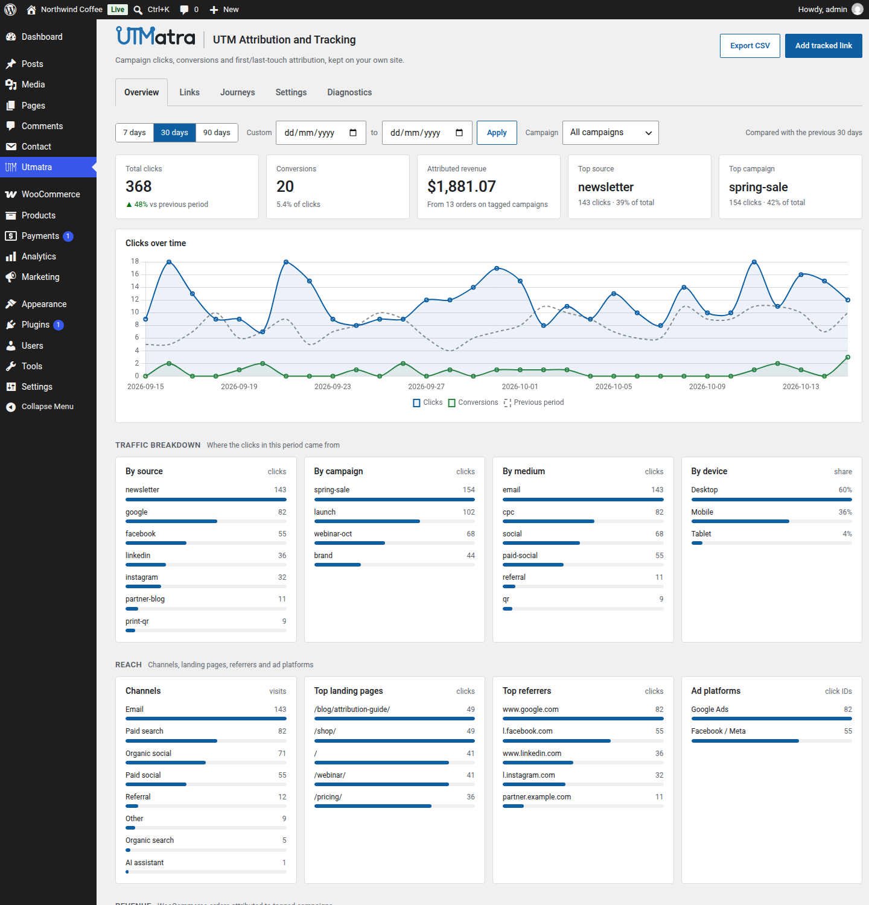
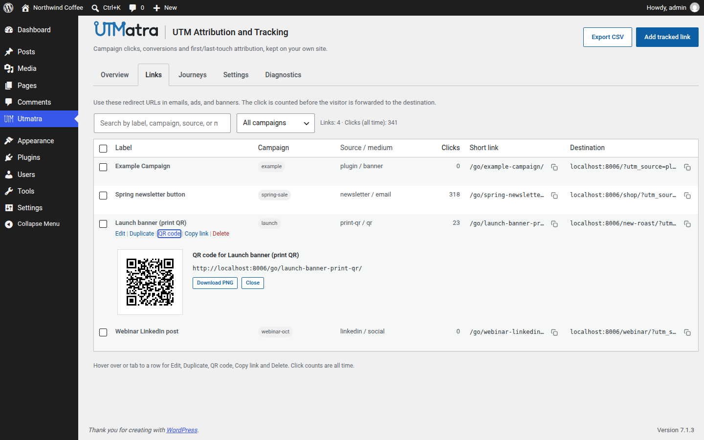
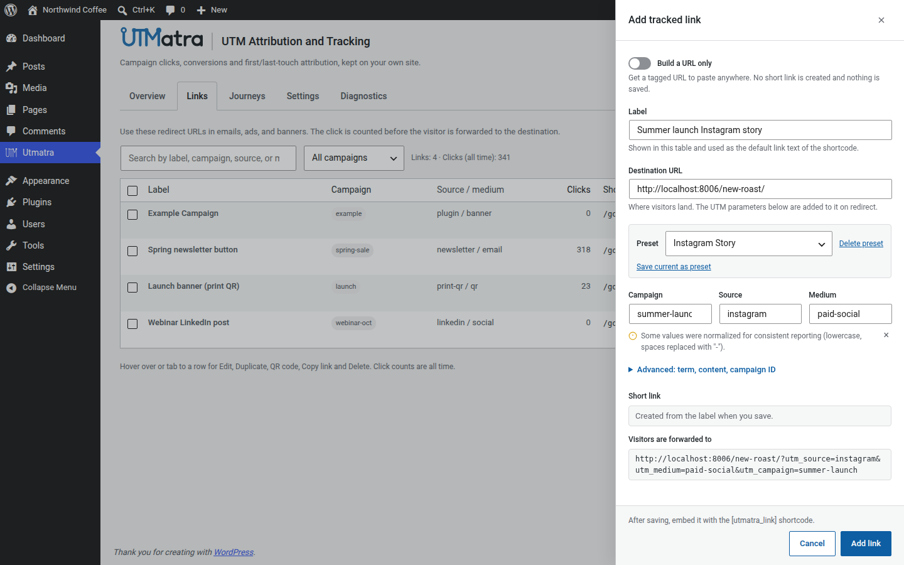
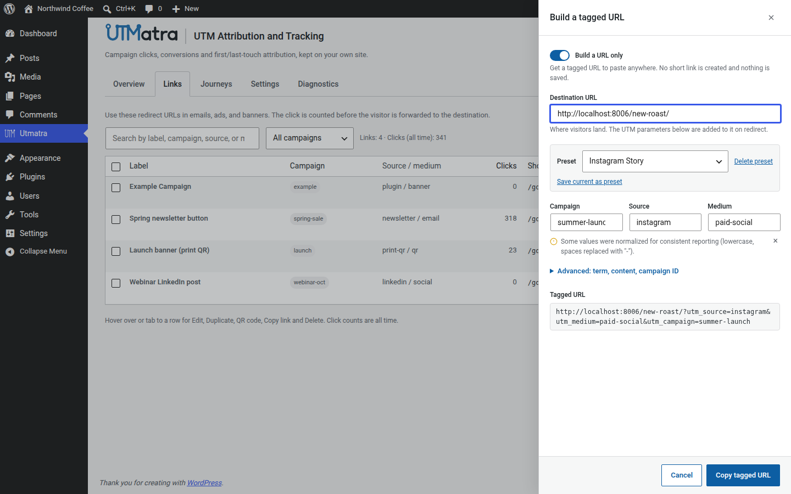
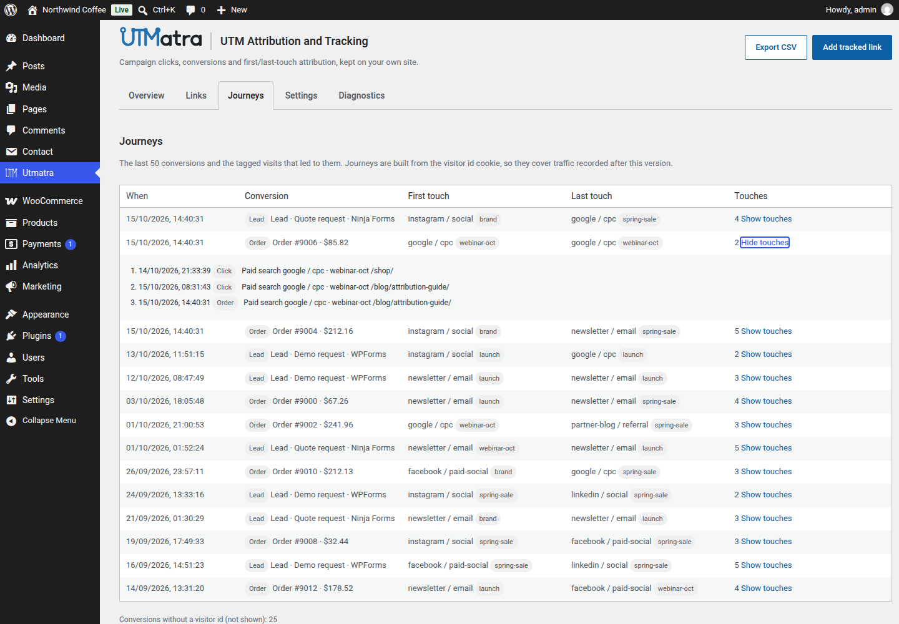
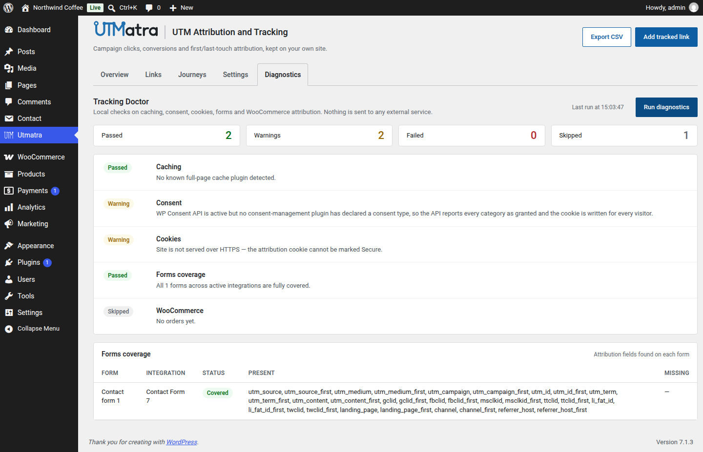

# Utmatra - UTM Attribution and Tracking

Self-hosted UTM and campaign tracking for WordPress: short links, QR codes, first/last-touch attribution, WooCommerce revenue attribution, form lead capture and a live dashboard. No third-party analytics service involved.




## Features

**Tracking**
- Cache-proof front-end beacon that records the first page of every visit and every UTM-tagged visit, even behind a full-page cache, with a server-side fallback for visitors without JavaScript.
- Channel classification at write time: direct, organic search, paid search, paid social, organic social, email, referral, AI assistant, display and affiliate.
- UTM parameters, ad click IDs (`gclid`, `fbclid`, `msclkid`, `ttclid`, `li_fat_id`, `twclid`) and up to ten custom parameters of your own (coupon, affiliate ID, promo code).
- First- and last-touch attribution cookie, gated on the [WP Consent API](https://github.com/rlankhorst/wp-consent-level-api).
- Bot filtering and click deduplication.

**Links**
- Pretty short links at `/go/{slug}/` that count the click and forward with the UTM parameters appended.
- A QR code per link, generated in the browser.
- `[utmatra_link]` shortcode, UTM naming presets and a build-a-URL-only mode.

**Reporting**
- Chart.js dashboard: clicks over time, source, campaign, medium, device, channel, landing page, referrer and ad platform.
- WooCommerce revenue attribution, with first/last touch on every paid order.
- Customer journeys: every tagged visit that led to an order or form lead.
- CSV export, a weekly email summary and a read-only REST API (`utmatra/v1`).
- Tracking Doctor diagnostics for caching, consent, cookies, form coverage and WooCommerce attribution.

**Forms and integrations**
- Attribution capture for Contact Form 7, Gravity Forms, Ninja Forms, Elementor Pro Forms, WPForms, Fluent Forms, Formidable Forms, Forminator and Bricks, plus any form with a matching hidden field.
- Signed lead and order webhooks for Zapier, Make, HubSpot and GoHighLevel.

**Privacy**
- IP addresses stored only as salted SHA-256 hashes.
- Configurable data retention (180 days by default).
- No outbound requests unless you configure a webhook. Chart.js, the QR library and Action Scheduler are bundled.

## Screenshots

**Short links and QR codes.** Every tracked link gets a `/go/` short link and a QR code you can download as a PNG.



**UTM naming presets.** Save a source and medium combination once, and apply it in one click. Values are normalized so `Paid Social` and `paid-social` never split your reports.



**Build a URL only.** Get a tagged URL to paste anywhere, without creating a short link.



**Customer journeys.** Every tagged visit that led to an order or form lead.



**Tracking Doctor.** Local checks for caching, consent, cookies, form coverage and WooCommerce attribution.



The full documentation (FAQ, filter reference, REST API reference, external services) is in [readme.txt](readme.txt).

## Requirements

- WordPress 6.9 or later
- PHP 8.0 or later
- WooCommerce is optional and enables revenue attribution

## Installation

Download the latest zip from [Releases](https://github.com/mahlamusa/utmatra-utm-attribution-and-tracking/releases), then upload it under **Plugins → Add New → Upload Plugin** and activate it. The dashboard is under **Utmatra** in the admin sidebar.

## Development

Clone the repository into `wp-content/plugins/utmatra-utm-attribution-and-tracking` and install the Composer dependency (Action Scheduler):

```bash
git clone https://github.com/mahlamusa/utmatra-utm-attribution-and-tracking.git
cd utmatra-utm-attribution-and-tracking
composer install
```

There is no JavaScript or CSS build step. The files in `assets/` ship as written.

Coding standards follow WordPress Core and are checked with PHP_CodeSniffer using `phpcs.xml`:

```bash
phpcs
phpcbf
```

Release scripts (they need `composer` and WP-CLI for the translations template):

| Command | What it does |
| --- | --- |
| `bash bin/build.sh` | Regenerates `languages/utmatra-utm-attribution-and-tracking.pot` |
| `bash bin/release.sh` | Builds the install zip in `releases/` |
| `bash bin/wp-org-publish.sh <version>` | Stages a WordPress.org SVN working copy, without committing |

The shipped plugin is built with `git archive`, so everything marked `export-ignore` in `.gitattributes` (this README, `bin/`, `specs/`, dev manifests) stays out of the zip.

## Bundled libraries

- [Chart.js](https://github.com/chartjs/Chart.js) 4.5.1, MIT
- [QR Code Generator](https://github.com/kazuhikoarase/qrcode-generator) by Kazuhiko Arase, MIT
- [Action Scheduler](https://github.com/woocommerce/action-scheduler), GPL-3.0, installed with Composer

## License

GPL-2.0-or-later. See [LICENSE.md](LICENSE.md).
